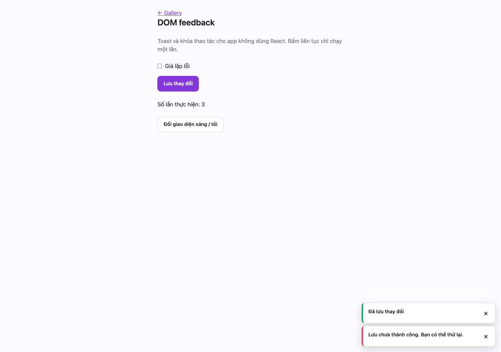
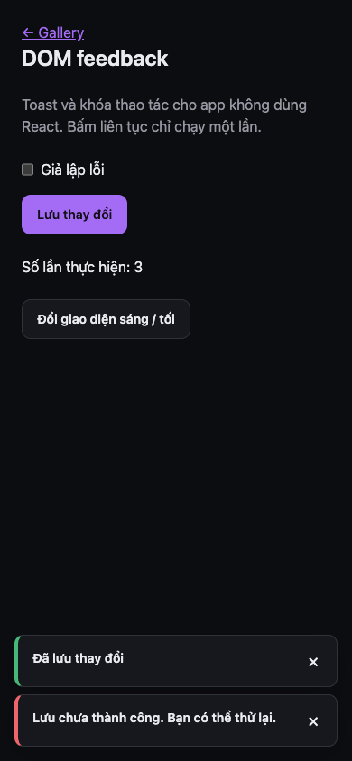

# DOM action feedback

For static apps using native JavaScript, copy `src/dom/feedback.mjs` and
`feedback.css`. Supply the existing `--ui-*` tokens from `src/styles/tokens.css`.
React apps keep using `Button` and `ToastProvider`.

```js
import { createActionGate, createToasts, setButtonPending } from './feedback.mjs';
const gate = createActionGate();
const toast = createToasts();
async function submit(button) {
  const release = gate.claim('save');
  if (!release) return;
  const restore = setButtonPending(button, 'Đang lưu…');
  try {
    await save();
    toast.show('success', 'Đã lưu');
  } catch (error) {
    toast.show('error', 'Chưa lưu được', { description: error.message });
  } finally {
    restore();
    release();
  }
}
```

Use `class="ui-button"`, with `data-variant="primary"` for the primary action.
The gate is synchronous: claim it before awaiting or starting provider work.
Keys let independent actions run separately. Use one key for mutually exclusive
operations on the same record. Release in `finally`.

Toasts use plain text, polite live announcements, up to three visible messages,
and deduplicate identical messages. Errors last eight seconds, other messages
four; hovering/focusing pauses dismissal. `duration: 0` makes a persistent toast.
The returned function dismisses that toast; `destroy()` clears all timers/nodes.
An open native dialog hosts its own notifications so they stay above its backdrop.

This client gate does not replace server-side concurrency, idempotency, or rate
limits. A failed network response does not prove the server did not complete the
operation. Reload its state before retrying writes.

Demo: `pnpm dev`, mở `/dom-demo.html`. Browser check: `rtk proxy python3 e2e/dom-feedback.py` (gallery đang chạy trên cổng 5173; Chrome CDP 9223).

## Preview




